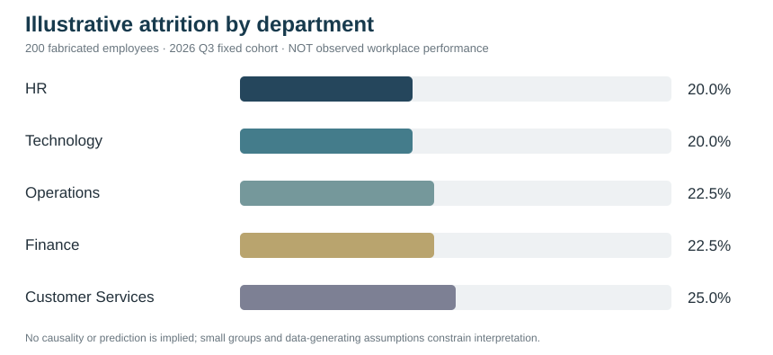

# Executive brief — synthetic attrition descriptive lab

**Classification:** Standalone portfolio demonstration, 200 fabricated employee records, no employer data or measured retention outcomes.

| Department | Fictional cohort | Fictional exits | Fixed-cohort fraction |
|---|---:|---:|---:|
| HR | 40 | 8 | 20.0% |
| Technology | 40 | 8 | 20.0% |
| Operations | 40 | 9 | 22.5% |
| Finance | 40 | 9 | 22.5% |
| Customer Services | 40 | 10 | 25.0% |
| **All groups** | **200** | **44** | **22.0%** |

### Interpretation
The percentages describe **artificially assigned labels**, not workforce behavior. Notably, the fabricated group counts differ substantially, but the generator was engineered for demonstration; **no department is genuinely at higher attrition risk**.

### Proposed employer action
Request actual approved workforce extracts and definitions; cross-check baseline and voluntary survey validity; align with HR, legal/privacy and analysts on suppressing small groups; document hypotheses and request stakeholder signoff.

### Deliverables
- Runnable stdlib Python script with validation checks.
- Four unit tests.
- Original 200-row CSV, evidence snapshot and GitHub-previewable SVG.
- Data dictionary and risk-aware method.

### No verified business impact
No performance improvement, prediction, successful intervention, or real HR data analysis is claimed.
