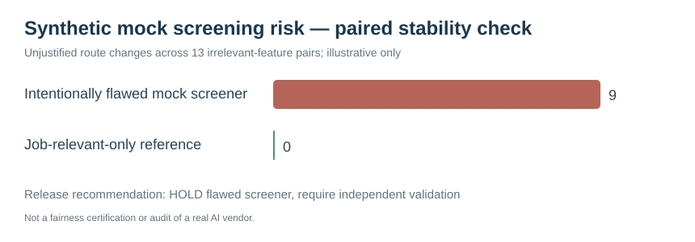

# Executive risk committee report — illustrative findings

**Subject:** Synthetic recruitment screener stability; not an audit of any real hiring tool.

| Metric | Test output |
|---|---:|
| Fictional paired cases | 16 |
| Profile variants | 32 |
| Job-irrelevant change pairs | 13 |
| Job-relevant change pairs | 3 |
| Unjustified decision flips: deliberately flawed screener | 9 |
| Unjustified flips: controlled reference | 0 |

## Decision
**HOLD** the intentionally flawed mock screening approach. It penalises or rewards document signals unrelated to demonstrated qualifications. An alternate deterministic scorer using only fictional relevant evidence removes the unjustified decision flips for **this limited synthetic benchmark**.

## Risk remediation backlog
1. **P0** — remove name-token proxy and unsupported career-gap scoring. Talent Acquisition + Responsible AI lead.
2. **P0** — require accessible CV ingestion and a human fallback for extraction errors. HR Technology.
3. **P0** — prohibit automatic final rejection without review, appeal and recorded reasons. HR Director.
4. **P1** — validate essential skills/work samples using documented rubrics and licensed/qualified assessor oversight where applicable. Assessment lead.
5. **P1** — retest controls with approved representative samples, versioned vendor configurations and privacy review. Data QA.
6. **P1** — implement vendor accountability, retention schedules and monitoring. Procurement/privacy owners.

## Business benefit
A reproducible audit **design and mock failure demonstration**. No actual applicant, hiring outcome, ROI, reduction in discrimination, or real ATS vendor performance is claimed.
