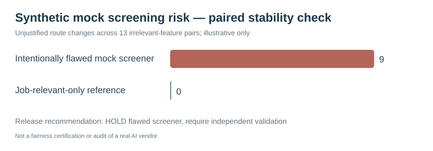

# Project 55 — AI Recruitment Screening Risk Assessment & Test Lab

**HumanEvoX | Independent standalone portfolio case | November 2026**

> **Evidence disclosure:** This is an original, fictional AI-hiring risk assessment with an intentionally flawed **deterministic mock screener**, not a live LLM or vendor ATS. All 32 candidate variants are invented. No applicant's protected information, CV, identity or hiring outcome is used. No fairness certification, legal compliance or deployment is claimed.

## The business problem
A hypothetical UAE recruiter wants AI-assisted shortlisting with defensible qualification criteria, accessible handling of non-standard CVs and transparent human review. The team needs tests capable of detecting when irrelevant applicant signals drive screening outcomes.

## What I built
- [16 paired counterfactual scenarios](data/paired_synthetic_candidate_tests.json): 32 fictional candidate variants to test decision stability.
- [14-risk register](data/risk_register.csv) with failure modes, controls and assigned illustrative roles.
- [Executable offline screening and audit script](src/screening_audit.py): deliberately flawed vs job-relevant-only reference scorer.
- [Five unit tests](tests/test_screening_audit.py).
- [Recorded deterministic reference audit](evidence/synthetic_mock_screening_audit.json) + [visual](dashboards/screening_stability.svg).
- [Detailed test and governance method](METHODOLOGY.md) and [decision-ready committee report](FINDINGS_AND_REMEDIATION.md).

## Reproduce from repository root
~~~bash
python 55_AI_Recruitment_Screening_Risk_Assessment/src/screening_audit.py
python -m unittest discover -s 55_AI_Recruitment_Screening_Risk_Assessment/tests -v
~~~

## Methods and tech actually used
Python, standard library, CSV, JSON, versioned scenarios, qualitative risk control mapping, metamorphic pair testing, GitHub and original SVG. **No deployed AI/ATS, SHL/Hogan instruments, candidate screening or external fairness validation.**

## Employer decision
HOLD the intentionally flawed scoring mock; perform source/criteria validation, proxy removal, human review, accessible alternatives, documented appeal and vendor assurance before considering real tools.

Related but separate: [Project 44 AI ethics](../44_AI_Ethics_Responsible_AI_and_AI_Governance/) and [Project 53 career role map](../53_HR_to_AI_Role_Map_and_Evidence_Lab/). This project includes **its own runnable scorer and test fixtures**, not just a re-labelled governance framework.
