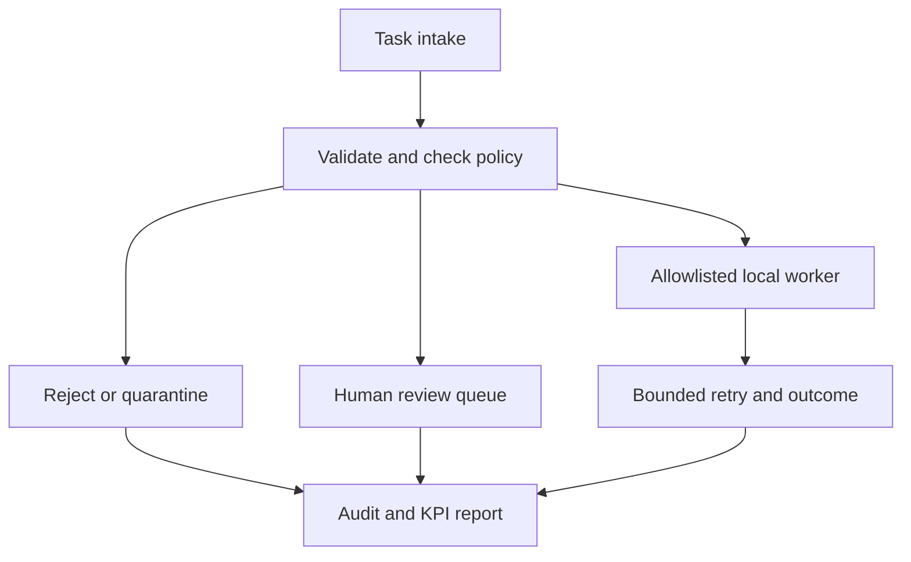

# AI Agent Management

**HumanEvoX Consultancy — independent portfolio prototype, synthetic data.**

An operational control-plane demonstration for managing automation candidates, task routing, bounded retries, exception handling, human review and auditable agent outcomes. This is self-directed work, not a commissioned client engagement. No production deployment or live model evaluation is claimed.

## Client requirement — fictional B2B operations scenario

An operations team needs to process document references, route requests, propose review appointments and perform simple reference checks without permitting arbitrary tools or uncontrolled decisions. Management needs an evidence trail, predictable failure handling, a measurable rollout and a clear separation between automation, human accountability and untrusted document content.

## Methodology

1. Discover and score candidate workflows by value, feasibility, data readiness, risk and adoption readiness (see [operating model](OPERATING_MODEL.md)).
2. Define typed task boundaries, allowed tools, risk gates and an exception taxonomy.
3. Execute a local deterministic reference implementation; record outcomes and hash-linked audit events.
4. Compare each outcome **and its output** with independently declared labels in 20 synthetic fixtures. Exercise failures, low confidence, attempted self-approval, disallowed tools, duplicates and known injection strings.
5. Separate observed control-plane results from proposed live-model, integration and adoption evaluation.

## Architecture and implemented workflow



Python's standard library implements task validation, four local workers, an in-memory idempotency guard, a three-attempt retry budget and SHA-256-linked audit records. Scheduling produces a proposal only. Review items never resume automatically, even if a caller supplies `approved=true`.

## Technology / AI used

| Layer | Status |
|---|---|
| Python, JSON, unittest, hashlib, regular expressions | Implemented and executed locally |
| AI agent lifecycle, tool allowlisting, approval boundaries and outcome analytics | Demonstrated as a deterministic simulation |
| Claude / OpenAI model calls and model selection | Integration design only; no API calls or model-performance claims |
| Claude Enterprise/Teams administration, Cowork, Claude Code, custom plugins, MCP and cron | Proposed enterprise operating procedures, not executed integrations |
| ERP, document management and Microsoft 365 | Proposed adapter contracts; no customer systems connected |

## Results — actual local execution

| Metric | Observed result |
|---|---:|
| Synthetic labelled cases | 20 |
| Outcome and output matches | 20/20 (100%) |
| Completed local simulations | 7 |
| Human review / rejected / quarantined | 4 / 5 / 2 |
| Retry exhausted / duplicate blocked | 1 / 1 |
| Unit tests passed | 4/4 |
| Live LLM calls / external writes | 0 / 0 |

The 35% completion rate reflects this deliberately exception-heavy fixture mix. It is **not** an automation rate for a real operation. These developer-authored fixtures establish regression behavior only, not broad generalization, model accuracy, production security or ROI. Raw events and computed metrics are in [reports](reports/).

## Run

Requires Python 3.10+; no packages, credentials or network required. From this project folder:

```bash
python src/manager.py
python -m unittest discover -s tests -v
```

The first command regenerates `reports/metrics.json` and `reports/audit.json`. Audit hashes are deterministic and include no timestamps; this is a reproducible local trace, not immutable production logging. Test execution checks output labels, self-approval denial, duplicate protection and audit tamper detection.

## Limits and next steps

- Reference extraction and routing are simple rules, not LLM reasoning or OCR. The compliance worker checks reference presence only, not legal/regulatory compliance.
- Confidence and transient failures are synthetic inputs, not calibrated scores or measured service failures.
- Injection rules cover known strings only. Do not treat them as a complete security boundary.
- The idempotency set is process-local; distributed locks, durable storage, authenticated approvals, tenant isolation and role-based authorization remain design work.
- Operational logs contain no source documents, but identifiers/results can still be sensitive in real deployments; data classification and retention controls must precede production use.
- Production release requires representative held-out data, live-model evaluation, authenticated connectors, access-control and adversarial testing, persistent audit storage, approvals and rollback rehearsals.

See [operating model and JD coverage](OPERATING_MODEL.md) for detailed requirements, proposed integrations, adoption, KPI definitions and build-versus-buy decisions.
