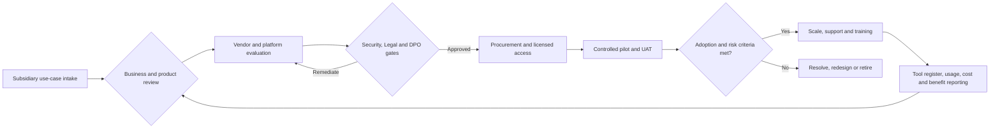

# AI Solutions Management
### Enterprise AI Tool Portfolio | Product Ownership | Vendor Management | Governance | Adoption | ROI

**HumanEvoX Consultancy — independent portfolio project**  
**Author:** Bircan Uzan  
**Project type:** End-to-end reference operating model, synthetic case study and runnable local reporting demonstration  
**Status:** Portfolio prototype / illustrative blueprint — **not** a Modon deployment, client engagement, production integration or proof of realised savings.

## Executive summary
This project demonstrates how an enterprise AI Solutions Manager can move from fragmented AI subscriptions to a **governed, measurable, multi-entity AI tool portfolio**. It combines business discovery, product roadmap prioritisation, vendor and contract control, licensing and renewals, information security/privacy reviews, rollouts, user enablement, incidents and executive reporting.

### Business challenge
A fictional GCC holding group has multiple subsidiaries using separate generative-AI products. Tools have inconsistent owners, opaque seat spend, unclear risk approvals and poor visibility into adoption and benefit. Leadership needs one lifecycle process and one portfolio register, without preventing business teams from experimenting safely.

### Proposed solution
1. Discover tools and business use cases; establish a product-led roadmap and acceptance criteria.
2. Compare and procure vendors against explicit commercial, integration, support, security and privacy criteria.
3. Record ownership, data classification, renewal dates, security/Legal/DPO approvals and access controls in a central tool register.
4. Deliver a governed pilot-to-scale rollout with business owners, IT, Security, Legal, Procurement and DPO.
5. Run enablement: champion networks, guidance, office hours and support escalation.
6. Track monthly licensed vs active seats, unit cost, risk flags and **scenario-model** benefit/ROI; report to D&T leadership.

## Deliverables / project navigation
| Deliverable | What it demonstrates |
|---|---|
| [Business case, objectives, product backlog](docs/01_business_case_and_product_backlog.md) | Product ownership, outcomes, prioritisation, user stories and acceptance gates |
| [Governance operating model](docs/02_governance_and_operating_model.md) | RACI, approval gates, AI policy, risk and data handling controls |
| [Vendors, licensing and renewal controls](docs/03_vendor_and_license_management.md) | Evaluation scorecard, SLAs, procurement/negotiation, seat allocation and renewals |
| [Rollout, training and incident playbooks](docs/04_rollout_adoption_and_support.md) | Cross-subsidiary programme delivery, UAT, adoption, champions and escalation |
| [KPIs and illustrative value reporting](docs/05_value_measurement_and_reporting.md) | Usage, cost, ROI assumptions, benefits validation and reporting cadence |
| [Cross-functional AI use cases](docs/06_cross_functional_use_cases.md) | Customer experience, contact centres, creative content, internal knowledge and loyalty examples |
| [Walkthrough for hiring managers](docs/07_hiring_manager_walkthrough.md) | 90-second explanation, role mapping, honest evidence boundaries |
| [Synthetic tool register](data/ai_tool_register_synthetic.csv) | AI inventory, ownership, data classification and control gates |
| [Synthetic usage input](data/monthly_usage_synthetic.csv) | Seat utilization, spend and illustrative benefit inputs |
| [Synthetic vendor scores](data/vendor_scorecard_synthetic.csv) | Weighted platform assessment inputs |
| [Portfolio report script](scripts/portfolio_report.py) | Reproducible no-dependencies monthly management reporting |
| [Automated tests](tests/test_portfolio_report.py) | Basic input and calculation checks |

## Named platform coverage (not a claim of hands-on production administration)
- **Claude:** policy-governed enterprise assistant and internal knowledge use cases.
- **Synthesia:** AI-assisted learning/video workflows and publishing controls.
- **Telnyx:** communications/voice workflow vendor, privacy and support considerations.
- **Midjourney:** creative ideation, branding/IP review and content approval considerations.
- **Existing transferable tooling:** Microsoft Copilot, Copilot Studio, Power Automate, Azure AI / Microsoft Foundry, Power BI, Excel, Python; LLM evaluation, human-in-the-loop and governance methodologies.

These four vendor names reflect technologies in a public job brief. This repository **does not assert actual licensed usage, vendor certification, contract negotiation or deployment** of those products. Pricing, seat counts, commercial terms and metrics in sample CSVs are entirely invented.

## Example architecture


## Run the synthetic reporting demo
Requires **Python 3.10+**, standard library only (no cloud access, API keys or personal data).

```bash
python "AI Portfolio/AI Solutions Management/scripts/portfolio_report.py" --output /tmp/ai_portfolio_report.md
python -m unittest discover -s "AI Portfolio/AI Solutions Management/tests" -v
```
The script defaults to CSVs in this project. It checks missing tools, duplicate IDs, invalid numbers and licensed-versus-active constraints; it flags tools lacking control approvals. Reports use hypothetical hours saved and hourly value assumptions rather than measured benefits.

## Management decisions and success criteria
- **No AI platform is provisioned** without risk classification, owner, approved purpose and the applicable Security/Legal/DPO gates.
- A pilot has named sponsors, budget owners, acceptance criteria, training, support and rollback paths.
- Duplicate or unused seats are reviewed monthly; renewals receive 90/60/30-day reminders.
- Adoption, cost and reported value are separately defined; ROI is **not claimed** until Finance validates attributable savings and costs.
- AI outputs used in customer, employee or financial decisions require documented human review.

## JD capability crosswalk
| Enterprise AI Solutions Manager responsibility | Artefact |
|---|---|
| Product roadmap, prioritisation, use cases | Business case and backlog |
| Project management across entities | Rollout phases, RACI and gate review |
| Vendor relations, contract, SLA, renewals | Vendor lifecycle playbook |
| Seat allocation, access, spend and ROI | Registry, monthly usage data and reporting script |
| IT Security, Legal and DPO coordination | Governance gates and checklist |
| Training, champions, user guides, office hours | Adoption playbook |
| Emerging platform / vendor recommendations | Weighted selection scorecard |
| Tool issues, vendor escalation | Incident matrix |
| Group-wide AI inventory and data handling | Tool register |
| AI in customer apps and loyalty | Cross-functional example use cases |

## Provenance and limitations
Prepared as an **independently designed interview/portfolio demonstration** aligned to publicly described AI Solutions Management responsibilities, using fictional enterprise scenarios and inputs. It does not imply affiliation with or work for Modon, ADNEC or any named entity; no company-owned or confidential material is included. Tool evaluation scores are examples, not independent product testing. Any client-facing implementation would require current vendor documentation, real commercial quotes, authorised information-security review and approval by relevant accountable teams.

[Enterprise AI portfolio](../README.md) · [HumanEvoX](https://humanevox.com) · [Public job brief](https://www.linkedin.com/jobs/view/4492565269/)
