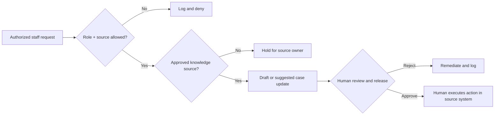

# Control map: fictional Atlas UAE knowledge assistant

| Control | Requirement | Synthetic demonstration | Production integration requirement |
|---|---|---|---|
| Identity | Verify enterprise identity and role | Static roles in JSON requests | Entra/Workspace SSO; server-side entitlements |
| Source boundary | No unapproved retrieval | source_approved flag | Connector-level identity propagation, source ACLs, DLP |
| Sensitive data | Deny unauthorized access | class-based rule | Data owner classification, retention, privacy impact review |
| Model quality | Grounded answers, policy evidence | No generation included | RAG citations, adversarial/quality evals and output restrictions |
| Human oversight | Review before HR action | status-only decision | Approval identity, queues, escalation, separation of duties |
| Side-effect prevention | No unapproved external sends/writes | publish_external always blocked | Scoped secrets, environment-level deny, allowlist and rollback |
| Audit | Log only minimum needed fields | case ID and decision | Protected event store, access logging and retention |

## Test strategy / failure handling
Functional: approved/public → safe draft routing. Negative: unauthorized role, unknown class, unapproved source, unsupported action, external release. Non-functional production requirements: permission regression, tenant isolation, privacy, rate limit, inaccessible backend, prompt injection, output hallucination, quality drift, latency, costs and recovery.

## Change management
Design change request → owner/security review → test/evaluation → UAT → human go/no-go → rollout → monitoring → rollback on failed guardrail.

**Security warning:** The Python code is a process-design demonstration, not a security-tested API gateway and must not be exposed as an authorization service.
