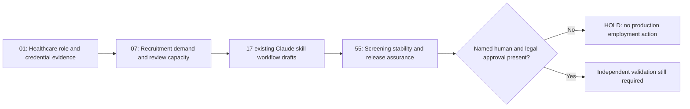

# Recruitment intelligence, controlled workflows and human-owned decisions

**One connected view of the 20 existing projects; no fifth parent category or new standalone projects.**



**Executive decision layer:** [CHRO / CAIO steering brief](EXECUTIVE_STEERING_BRIEF.md), [human–AI operating model](HUMAN_AI_RECRUITMENT_OPERATING_MODEL.md) and [economic options](07_Talent_Workforce_Intelligence/EXECUTIVE_INVESTMENT_OPTIONS.md) sit *above* this sequence rather than creating another recruiting tool.

## Exclusive capability boundaries
| Existing project | Responsible for | Not responsible for |
|---|---|---|
| [01 Healthcare Recruitment](01_AI_Enabled_Recruitment_Healthcare/) | Clinical role readiness and evidence-source gaps | Credential authentication, actual clinical hiring decisions |
| [07 Talent & Workforce Intelligence](07_Talent_Workforce_Intelligence/) | Requisition volume, fictional review queue and reviewer capacity modelling | Qualified-candidate probabilities or sourcing actual talent |
| [17 Claude-compatible workflow designs](CLAUDE_WORKFLOW_HANDOFFS.md) | Draft role design, structured selection, scheduling, offer and cross-border handoffs | Live Claude runs, ATS writes, messaging or candidate selection |
| [55 Screening Risk & Assurance](55_AI_Recruitment_Screening_Risk_Assessment/) | 16 paired synthetic screening tests, risk governance, 17-skill guardrail audit, release HOLD | Deployed ATS, actual fairness certification or authorised algorithmic hiring |

## End-to-end operating process
1. Define hiring needs: evidence-backed role purpose, essential criteria, location, country and approving managers. Missing official rules remain unresolved.
2. Plan sourcing/reviewer operations using the fictional demand/queue/effort model in Project 07; this is not a conversion or predictive hiring model.
3. Route a draft to the relevant Claude-compatible workflow. Its SKILL.md requires source IDs, missing inputs and a named reviewer. Workflow output is **never** treated as an approval or a task execution.
4. Project 55 evaluates deterministic mocked screening instability, the original 14-item risk register and the presence of decision protections in all 17 SKILL documents.
5. The **production release must remain HOLD** because no real legal/privacy/selection validity, independent fairness, accessibility, signed human approvals or ATS/LLM evidence exists.

## Reproducibility
```bash
python -m unittest discover -s "AI-enabled Recruitment Portfolio/01_AI_Enabled_Recruitment_Healthcare/tests" -v
python -m unittest discover -s "AI-enabled Recruitment Portfolio/07_Talent_Workforce_Intelligence/tests" -v
python -m unittest discover -s "AI-enabled Recruitment Portfolio/55_AI_Recruitment_Screening_Risk_Assessment/tests" -v
```

[GitHub Actions checks](../.github/workflows/recruitment-portfolio-ci.yml) regenerate synthetic evidence and verify safe release gates. **No real candidate data**, compensation/immigration decisions, communications, deployed AI agents or measured business impact.
