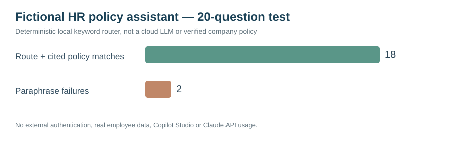

# Project 56 — HR Policy Assistant & 20-Question Evaluation Lab

**Standalone HumanEvoX portfolio project | Original fictional HR service assistant**

> **Truthful evidence statement:** A working **offline deterministic Python policy assistant** is supplied with five fictional, versioned HR workflow sources, CLI interaction, evaluation script, seven unit tests and 20 question/expected-answer fixtures. It is **not an LLM, Claude, Copilot Studio, live HRIS, approved UAE policy service or production deployment**. Any output is an illustrative source-navigation response, not legal advice.

## Hypothetical client problem
Routine policy questions, undocumented exception handling and third-party confidentiality requests create unnecessary HR service workload and risk. The solution should guide employees to approved policy sources, refuse disclosure of other workers' information and escalate exceptions for human resolution.

## Independent project files
- [Fictional policy catalogue (five sources)](data/fictional_policy_catalog.json)
- [Interactive offline Python assistant](src/policy_assistant.py)
- [Twenty question / expected-route cases](data/20_question_benchmark.json)
- [Deterministic evaluation runner](src/evaluate_policy_assistant.py) and [reference test logs](evidence/reference_policy_evaluation.json)
- [Seven unit tests](tests/test_policy_assistant.py)
- [Methodology, rubrics and limits](METHODOLOGY_AND_TEST_PLAN.md)
- [Escalation and governance workflow](EXCEPTION_ESCALATION_AND_GOVERNANCE.md)
- [Evaluation findings and roadmap](FINDINGS_AND_ROADMAP.md)
- [GitHub-visible evaluation dashboard](dashboards/assistant_evaluation.svg)

## Run from repository root (Python 3, no external packages or API keys)
~~~bash
python 56_HR_Policy_Assistant_20_Question_Evaluation/src/policy_assistant.py --question "How do I request annual leave?"
python 56_HR_Policy_Assistant_20_Question_Evaluation/src/policy_assistant.py
python 56_HR_Policy_Assistant_20_Question_Evaluation/src/evaluate_policy_assistant.py
python -m unittest discover -s 56_HR_Policy_Assistant_20_Question_Evaluation/tests -v
~~~

**Preserved known gaps:** Two of the 20 scripted queries use paraphrases absent from the rule-based vocabulary. They remain failed test cases and have documented remediation recommendations. No percentages represent AI-model factual accuracy on real-world prompts.

## Tools actually used
Python 3 standard library, JSON, GitHub, source-versioning, original SVG graphics, synthetic test fixtures and human-in-the-loop workflow documentation. No external APIs, genuine employee records or company HR policies.

## Use for interviews
“I wrote a local offline HR policy assistant using a versioned fictional policy catalogue, developed a 20-question benchmark covering routine services, human escalation and privacy, and reported failures without hiding them. It is an educational deterministic prototype, and I documented steps required for an authorised enterprise Copilot deployment.”

Related: [Project 43 cloud integration design / local policy prototype](../43_Microsoft_Copilot_Studio_HR_Service_Agent_Prototype/) and [Project 42 human–AI governance](../../../Workforce%20Transformation/42_Human-AI_Workforce_Design_and_Agent_Governance/). This is a separate standalone **five-source + twenty-prompt** case, not a claim of having deployed those other tools.
