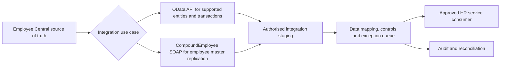

# SAP SuccessFactors Employee Central solution architecture

## Logical system boundary

## Interface decision matrix
| Requirement | SAP interface | Tradeoff |
|---|---|---|
| Read supported employee/foundation/entity objects | Employee Central OData API | Supported entity, permissions, pagination and version vary |
| Write eligible EC entities | OData where officially supported | Restrict write privileges and use required business approvals |
| Employee master replication full/delta/snapshot | CompoundEmployee SOAP API | Hierarchical response, replication-focused; not general write API |
| Historical entity access | OData where supported | Verify entity semantics and effective-dated data |
| Deliver replication to multiple systems | SAP Integration Suite / Cloud Integration where licensed | Tenant connectivity, versioning, retries and auditability |
| Payroll/benefits downstream | Approved HR/Finance integration | Never assume direct payroll decision authority |

## Design constraints
- CompoundEmployee is SOAP/SFAPI-based and intended for replication, with documented modes and field limitations.
- RBP (role-based permissions) and API-specific permissions must be verified per instance; avoid overprivileged access.
- Data privacy, export scope, residency and allowed data use must be approved separately for each country/entity.
- A terminated employment event, a correction and a late effective-dated change should not be treated as identical.
- Do not invent real SAP entities, endpoints or tenant credentials in a portfolio simulation.

**Official technical references:** [SAP EC API choice](https://help.sap.com/docs/successfactors-platform/sap-successfactors-api-reference-guide-odata-v2/when-are-employee-central-odata-apis-used), [CompoundEmployee API](https://help.sap.com/docs/successfactors-employee-central/employee-central-compound-employee-api/introduction-to-compoundemployee-api).

**Evidence status:** Conceptual design only.
