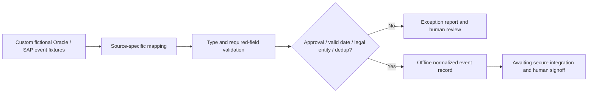

# Canonical event adapter, integration boundary and test strategy

## Conceptual pipeline

## Canonical output fields
`source_system`, `event_id`, `worker_key`, `event_type`, `effective_date`, `legal_entity`, `version`, `human_approval_required`.

## Control contract
- Accepted input sources: `ORACLE_FUSION_HCM` and `SAP_SUCCESSFACTORS_EC` **fictional formats only**.
- Allowed lifecycle actions: `HIRE`, `TRANSFER`, `EXIT`.
- Effective date: Python `date.fromisoformat`; invalid calendar dates rejected.
- Version: positive integer, reject booleans and string versions.
- Approved: literal boolean `true` (not strings or numeric flag).
- Legal entity: a safe fictional allowlist.
- Identity: worker key is an obvious synthetic identifier.
- Replay: within a batch, identical `source, event_id, version` is rejected, regardless of previous acceptance outcome. Actual distributed idempotency requires durable state.
- Reject unknown fields from canonical output; do not log secret values or personally identifiable fields.

## Test inventory
| Case | Expected |
|---|---|
| Both sources valid | Two accepted canonical events |
| Missing person/worker key | Exception |
| Duplicate replay | Second event rejected |
| Unapproved change | Rejected for named human action |
| Invalid date | Rejected |
| Unknown source | Rejected safely |
| Unsupported action or entity | Rejected |
| Bad version type | Rejected |
| Extra sensitive source field | Not copied into canonical output |
| Control totals | received = accepted + rejected |

## Real-world extension checklist
Only after authorised tenant credentials are available: real API clients, semantic SAP/Oracle payload parsing, access token vault, version-specific schema fixtures, durable outbox, exponential retries, dead-letter operations, encryption, privacy approval, integration UAT with source and target systems and human release gates.

This repository supplies **none** of those production connections.
