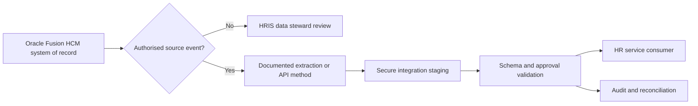

# Oracle Fusion Cloud HCM: architecture decision record

## Conceptual flow

## Integration-method decision table
| Business need | Candidate Oracle feature | Design constraint |
|---|---|---|
| Query a limited worker resource | HCM REST API | Respect roles, effective dates, pagination and service limits |
| Initial large-scale import | HCM Data Loader (HDL) | Controlled inbound load, mapping, validation and least-privilege access |
| Scheduled bulk outbound data | HCM Extracts | Reconcile extract counts and approved downstream scope |
| Detect supported employment change | HCM Atom feeds | Supported transactions only; never assume universal event coverage |
| Connect complex consumers | OIC if licensed, otherwise approved middleware | Secrets, retry/dead-letter, event IDs and incident ownership |
| Final pay, EOS or salary change | Separate HR/Finance controls | Never calculate, authorise or transmit payments through this case |

## Authority and data boundaries
- **HR master data:** worker, assignment, legal entity and effective dates.
- **Integration:** map only approved minimal fields to a vendor-neutral event.
- **Finance/Payroll:** retains financial change authority and independent controls.
- **Security:** denies direct access to medical, identity, salary and bank records not essential to integration.
- **Support:** alerts named HRIS/IT owners; no auto-approval on invalid events.

## Trade-offs
REST offers discrete authorised operations, while bulk interfaces suit volume. Atom feeds support eligible transactions but differ from full snapshots. All mechanisms require tenant-specific scope validation, rate/error policies and a tested release process.

**References:** [Workers REST](https://docs.oracle.com/en/cloud/saas/human-resources/farws/api-workers.html), [Oracle Fusion Cloud HCM REST reference](https://docs.oracle.com/en/cloud/saas/human-resources/farws/).

**Status:** Architecture decisions only; no tenant execution.
