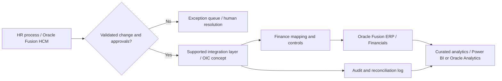

# Oracle Solution Architecture

**HumanEvoX independent architecture and transformation work sample** | November 2026

**Purpose:** Demonstrate a business-led, end-to-end Oracle solution architecture methodology for a fictional GCC enterprise implementing an employee and workforce-cost control process across HR and Finance.

**Evidence boundary:** This project is a synthetic design exercise, not a customer implementation, Oracle partner engagement, deployed Fusion HCM/ERP/OCI/OIC integration, certification, product demo, or claim of 12+ years as an Oracle solution architect. No live tenant, credentials or confidential data were used. Bircan's direct Oracle professional experience is separately documented as Oracle HCM & Cloud Applications Consultant (2013-2016).

## Business scenario

A fictional diversified group has six subsidiaries. Worker lifecycle changes (hire, transfer, cost center, leave, termination) are coordinated inconsistently between HR and Finance. The group needs one governed business process that supports accurate worker data, finance costing, reconciliations, analytics, exception routing and access controls.

**Proposed logical stack** (illustrative, products subject to licensed scope and design validation):

- **Oracle Fusion Cloud HCM:** worker master data, assignments, organization/cost center references and HR approvals.
- **Oracle Fusion Cloud ERP / Financials:** finance-owned general ledger, costing and accounting outcomes; no assumption that HCM owns finance postings.
- **Oracle Integration Cloud (OIC) / supported APIs or file interfaces:** event transport, mapping, retries, idempotency and error handling.
- **OCI / enterprise security & identity tools:** conditional hosting/integration options, encrypted connectivity, secrets management, identity controls and observability.
- **Oracle Analytics / Power BI:** curated, access-controlled reconciliation and workforce-cost dashboards.
- **Oracle AI features or Microsoft Copilot:** optional recommendations/draft explanations only, behind human approval. No autonomous payroll/finance posting.

## Architectural decision evidence
[HCM-to-Finance architectural decisions, failure controls and reconciliation](05_Finance_Integration_Architecture_Decisions.md) — deliberately distinct from HCM workforce configuration and HDL ingestion mechanics.

## Portfolio deliverables

1. [Business case and requirements](01_Business_Case_and_Requirements.md) - stakeholder discovery, business capability map, architecture decisions, functional / non-functional requirements, benefit hypotheses.
2. [Target architecture and integration](02_Target_Architecture_Integration_and_Data.md) - component boundaries, source of truth, logical flows, data contracts, migration and analytics.
3. [Security, AI and governance](03_Security_AI_and_Governance.md) - segregation of duties, privacy-by-design, risk register, human approval gates, audit evidence.
4. [90-day delivery roadmap and UAT](04_Delivery_Roadmap_and_UAT.md) - phases, dependencies, RACI/RAID, acceptance criteria and vendor coordination.
5. [Enterprise architecture decisions](05_Finance_Integration_Architecture_Decisions.md) - Finance ownership, error recovery and control totals.
6. [Validation lab](src/validate_changes.py) - pure-Python synthetic event validation with [unit tests](tests/test_validation.py), no external services.

## Role coverage

| Accenture Oracle Solution Architect requirement | Work-sample evidence |
|---|---|
| Business discovery, design workshops | Discovery questions and stakeholder map |
| Business-to-solution traceability | Requirements table with architecture and test references |
| End-to-end solution architecture | Logical HCM / integration / ERP / analytics / security design |
| Data and integration | Source-of-truth matrix, example schema, error/replay handling |
| Security, operations and governance | Role segregation, privacy controls, observability and checkpoints |
| Roadmap and delivery partnership | Staged milestones, dependencies, stage gates, RACI and RAID |
| AI and analytics opportunities | Optional decision-assistance concepts with manual approvals |
| Proposals and executive communication | Scope, option tradeoffs, benefits hypotheses and decision log |

**Not represented:** Installed/configured Oracle HCM or ERP, OCI or OIC credentials, end-to-end tested Oracle integration, actual cost savings, client approvals, production security assessment, SLA guarantees.

See the parent [Oracle Fusion HCM category](../README.md) for functional setup, release governance and HCM-specific interface engineering.

[Return to portfolio home](../../../README.md)
