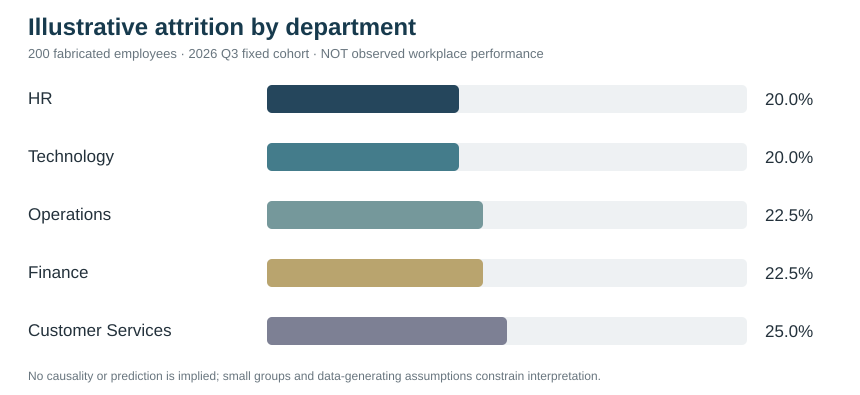

# Project 54 — Attrition Analysis on a Synthetic 200-Employee Dataset

**Independent, standalone HumanEvoX HR/AI portfolio project**

> **Evidence boundary:** This project uses 200 fabricated fictional employees. A Python standard-library analysis, four unit tests, a descriptive JSON reference snapshot and an original SVG dashboard are supplied. It is a **reproducible demonstration**, not real company analytics, causal research, an attrition prediction model or proof of reduced turnover.

## New: Aggregate forecasting, scenario validation and responsible decision support

The **original 200-employee fixed-cohort attrition example remains unchanged**. A separate invented **24-month aggregated workforce series** now demonstrates time-ordered forecasting and hiring/exits sensitivity; it is **not** derived from the original cohort and is not an individual attrition prediction.

- [Forecast model card and rigorous usage limits](FORECAST_MODEL_CARD_AND_VALIDATION.md)
- [Independent synthetic monthly workforce series](data/synthetic_monthly_workforce.csv)
- [Standard-library rolling-origin forecast and scenario engine](src/workforce_scenario_forecast.py)
- [Additional unit tests](tests/test_workforce_scenario_forecast.py)
- [Reproducible synthetic forecast and sensitivity output](evidence/forecast_scenario_synthetic.json)
- [Executive review record with human decision controls](DECISION_SIMULATION_REVIEW.md)

Run from Project 54:
```bash
python src/workforce_scenario_forecast.py --out evidence/forecast_scenario_synthetic.json
python -m unittest discover -s tests -v
```

[Four-project intelligence pipeline](../WORKFORCE_INTELLIGENCE_PIPELINE.md) · [Executive scorecard](../52_HR_People_Analytics_Research_Dashboard_Library/workforce_intelligence_scorecard.html)

## Business pain point
A hypothetical UAE HR director wants a trustworthy initial view of employee departures. Before commissioning dashboards, leaders need transparent numerators/denominators, source checks, stakeholder interpretation and privacy controls.

## What is actually built
1. [200-row fictional dataset](data/synthetic_employee_cohort.csv) with five equally sized departments.
2. [Python descriptive analyst](src/analyze_attrition.py), validating IDs, exit flags and input types.
3. [Four unit tests](tests/test_analysis.py) and [reference metrics](evidence/baseline_results.json).
4. [Department attrition dashboard SVG](dashboards/attrition_by_department.svg) rendered directly on GitHub.
5. [Field definitions and synthetic generation](DATA_DICTIONARY.md), [method and ethics](METHODOLOGY_AND_ETHICS.md), [executive findings](RESULTS_AND_EXECUTIVE_BRIEF.md).



## Reproduce with Python 3 (no packages or accounts)
~~~bash
python "People Analytics & HR Data/54_Attrition_Analysis_200_Employee_Synthetic_Case/src/analyze_attrition.py"
python -m unittest discover -s "People Analytics & HR Data/54_Attrition_Analysis_200_Employee_Synthetic_Case/tests" -v
~~~

## Tools and scope
**Actually authored:** Python, CSV, JSON, SVG, Markdown, GitHub. Power BI/SQL production pipelines are not part of this implemented project. Percentages use **exits divided by the fictional fixed cohort** rather than a changing average workforce denominator.

## Portfolio positioning
HR reporting, HR transformation, workforce analytics coordination and data-quality governance. Links to [Project 03 people analytics](../03_People_Analytics_AI/) and [Project 52 dashboard library](../52_HR_People_Analytics_Research_Dashboard_Library/), but provides a new **self-contained input-to-output lab**.

## Suggested stakeholder narrative
“I designed a fictional HR attrition case with 200 synthetic records, documented metric limitations, produced a reproducible Python breakdown and generated a business-facing chart. It is a portfolio exercise, not a real employer retention result.”
