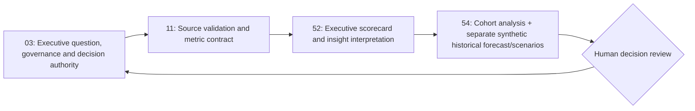

# HumanEvoX | Connected people intelligence workflow

**Four existing projects; one complementary value chain. No fifth project, no copied standalone dashboards, no duplicated attrition model.**



## Division of work (source of truth)
| Project | Owns | Does not own |
|---|---|---|
| [03 — Strategy and decision governance](03_People_Analytics_AI/) | Sponsor question, decision register, KPI ownership and ethical release | Data ingestion, dashboards or forecasting algorithms |
| [11 — Trusted data & descriptive analytics](11_Data_Analytics_for_AI_in_HR/) | Synthetic 500-record input, row validation, data dictionary and aggregate KPI calculation | Causal inference, attrition prediction or personal risk scores |
| [52 — Insight visualization](52_HR_People_Analytics_Research_Dashboard_Library/) | Existing 60 dashboard concepts plus a **distinct executive measurement gate** and offline scorecard | Duplicate source metrics or separate forecasting engine |
| [54 — Workforce scenarios and validation](54_Attrition_Analysis_200_Employee_Synthetic_Case/) | Existing 200-person fixed-cohort attrition description, **independent** 24-month aggregate simulation, time-ordered forecast comparison, sensitivity scenarios and human review | Individual attrition prediction, real workforce time series or automated staffing decisions |

## Data lineage & non-join warning
- Project 11's original [500-row synthetic HR data](11_Data_Analytics_for_AI_in_HR/synthetic_hr_data.csv) is one fictional employee snapshot. The `exit_12m` flag cannot be dated to specific months.
- Project 54's original [200-row 2026-Q3 fixed cohort](54_Attrition_Analysis_200_Employee_Synthetic_Case/data/synthetic_employee_cohort.csv) is **a separate fabricated population**. It has no real historical time series and should never be merged with the 500-row Project 11 file.
- Project 54's **new 24-month aggregate synthetic workforce history** is a *third, unrelated teaching fixture* built to demonstrate rolling-origin evaluation. Forecast comparisons on invented data are not evidence of employer predictive performance.
- Project 52's offline scorecard embeds named versioned JSON snapshots **from the two relevant source projects**; it does not join the underlying populations.

## Run order from repository root
```bash
python "People Analytics & HR Data/11_Data_Analytics_for_AI_in_HR/src/trusted_workforce_metrics.py" --out "People Analytics & HR Data/11_Data_Analytics_for_AI_in_HR/evidence/trusted_workforce_metrics.json"
python -m unittest discover -s "People Analytics & HR Data/11_Data_Analytics_for_AI_in_HR/tests" -v
python "People Analytics & HR Data/54_Attrition_Analysis_200_Employee_Synthetic_Case/src/analyze_attrition.py"
python "People Analytics & HR Data/54_Attrition_Analysis_200_Employee_Synthetic_Case/src/workforce_scenario_forecast.py" --out "People Analytics & HR Data/54_Attrition_Analysis_200_Employee_Synthetic_Case/evidence/forecast_scenario_synthetic.json"
python -m unittest discover -s "People Analytics & HR Data/54_Attrition_Analysis_200_Employee_Synthetic_Case/tests" -v
```

Open [executive scorecard HTML](52_HR_People_Analytics_Research_Dashboard_Library/workforce_intelligence_scorecard.html) locally in a browser after downloading the file; the HTML is **self-contained** and includes the committed synthetic snapshots. It does not dynamically read later JSON changes: rerender/reconcile its embedded snapshot if the source data changes.

## Gating before a real employer use
1. Data provenance, lawful basis, retention, quality and population denominators verified.
2. Metric dictionary and selection bias reviewed; no single-employee decisioning.
3. Time-ordered out-of-time holdout, leakage test, baseline comparison and uncertainty/sensitivity recorded.
4. Group fairness, access controls and privacy risks assessed with minimum reportable group size and suppressed small cohorts.
5. Human CHRO, Finance and workforce-planning decision gate; no autonomous layoffs, hiring, compensation or individual attrition-risk targeting.

**Evidence claim:** A synthetic, locally reproducible people intelligence example with documented assumptions and validations; neither production predictive AI nor achieved organisational outcomes.
