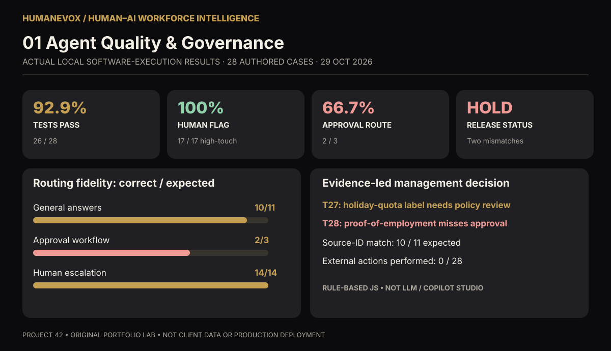

# Human–AI Workforce Design and Agent Governance | Project 42

**Bircan Uzan | HumanEvoX | UAE professional-services industry application**

## NEW — Human–AI Workforce Intelligence dashboards

**[Explore three executive dashboards](dashboards/README.md)** — a [downloadable, interactive HTML dashboard](dashboards/human_ai_workforce_dashboard.html), three GitHub-previewable SVG charts and a [methodology / technical stack / business pain points / outcomes report](DASHBOARD_METHODOLOGY.md). Designed for a hypothetical UAE professional-services HR client need. Dashboard 1 uses **actual recorded local JavaScript rule-engine evaluations** from Project 43 (26/28 full passes, 17/17 required human flags, 2/3 correct approval routes, **HOLD**). Dashboard 2 is an editable **illustrative** workforce time model; Dashboard 3 is an **unvalidated** hiring evidence and governance checklist. **None represents a real customer deployment, measured cost reduction, LLM or Power BI implementation.**

## Purpose and evidence status
An original **industry-based HR service design and governance laboratory** built around the challenge of supervising software agents like digital workers. It draws on HR competency design, assessment-centre evaluation, probation, performance review, RACI, process mapping and change management. This is **not a commissioned client project**. The industry setting and sample policies are illustrative; no company is identified or implied as a client.

### What is now hands-on
We built and executed a **working local, deterministic HR service assistant prototype** in [Project 43 — Microsoft Copilot Studio HR Service Agent Prototype](../../Agentic%20AI%20development/AI%20in%20HR%20%26%20Agentic%20Automation/43_Microsoft_Copilot_Studio_HR_Service_Agent_Prototype/). The engine is rule-based JavaScript, **not an LLM, Microsoft Copilot Studio deployment or autonomous agent**. It responds to general sample policy FAQs, recommends human escalation for sensitive/unsupported requests and flags employment-letter drafts for human approval (no actual approval or message sent).

#### Evidence-based answer to the interview question
**Q: “Which AI agent did you actually test, what did it respond, and how did you capture the evidence?”**

**A:** I tested **HR Service Agent Lab v0.1.0**, a real locally executed **rule-based conversational prototype** in [agent.js](../../Agentic%20AI%20development/AI%20in%20HR%20%26%20Agentic%20Automation/43_Microsoft_Copilot_Studio_HR_Service_Agent_Prototype/agent.js). I did **not** test a Copilot Studio-hosted agent or LLM. For “What is the annual leave policy?” it returned:

> Annual leave requests go through the HR case team and require manager approval. Individual entitlements and balances must be checked by an authorised human. [Source: HR-POL-002, v0.1; LABORATORY SAMPLE — NOT UAE LEGAL ADVICE]

For “What's my remaining leave balance?” it declined personal account access and returned `HUMAN_ESCALATION`. For an employment confirmation letter, it returned `APPROVAL_REQUIRED`, without sending or issuing anything. I executed 28 prompts, compared actual decisions and source IDs with authored expected results, and saved **all verbatim responses and traces** in [dated evaluation evidence](../../Agentic%20AI%20development/AI%20in%20HR%20%26%20Agentic%20Automation/43_Microsoft_Copilot_Studio_HR_Service_Agent_Prototype/evidence/2026-10-29_test_run.json), with a reproducible [test runner](../../Agentic%20AI%20development/AI%20in%20HR%20%26%20Agentic%20Automation/43_Microsoft_Copilot_Studio_HR_Service_Agent_Prototype/test_agent.js). **26/28 (92.9%)** matched; two intent synonyms failed; release recommendation is **HOLD**. These are observed local-code outputs, not AI model responses or measured production outcomes.

## Framework contents
- [Sector application and As-Is / To-Be design](CASE_STUDY.md)
- [Governance, controls, methodology and RACI](GOVERNANCE_AND_METHODS.md)
- [Historical 12-row synthetic exercise](data/agent_assessment_cases.csv) and [offline scorecard script](scripts/evaluate_agent.py) — **different dataset** from real code execution in Project 43
- [Probation and performance assessment](AGENT_PERFORMANCE_REVIEW.md)
- [30/60/90-day deployment readiness and value](ROLLOUT_AND_VALUE.md)
- [Working local prototype, verbatim test outputs and Microsoft Copilot Studio build guide](../../Agentic%20AI%20development/AI%20in%20HR%20%26%20Agentic%20Automation/43_Microsoft_Copilot_Studio_HR_Service_Agent_Prototype/)

## Tools actually used vs planned
**Used:** GitHub, Markdown, ChatGPT-assisted authoring, JavaScript offline conversational logic (Project 43), 28 actual program-execution tests, JSON trace capture, Python offline synthetic-score calculator (Project 42).

**Not used/verified in a live tenant:** Microsoft Copilot Studio, Power Automate, Teams Approvals, SharePoint grounding, Entra ID, Azure AI Foundry and Power BI. All remain proposed integration targets. NIST AI RMF is a methodology reference, not compliance certification.

**Disclosure:** Reproducible real outputs support a hands-on prototype claim, **not** a production-grade, LLM-based, independently audited or deployed Microsoft agent claim. © 2026 Bircan Uzan — All Rights Reserved.
