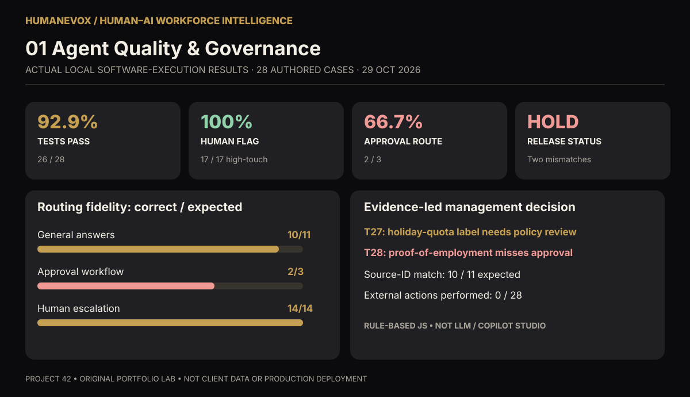
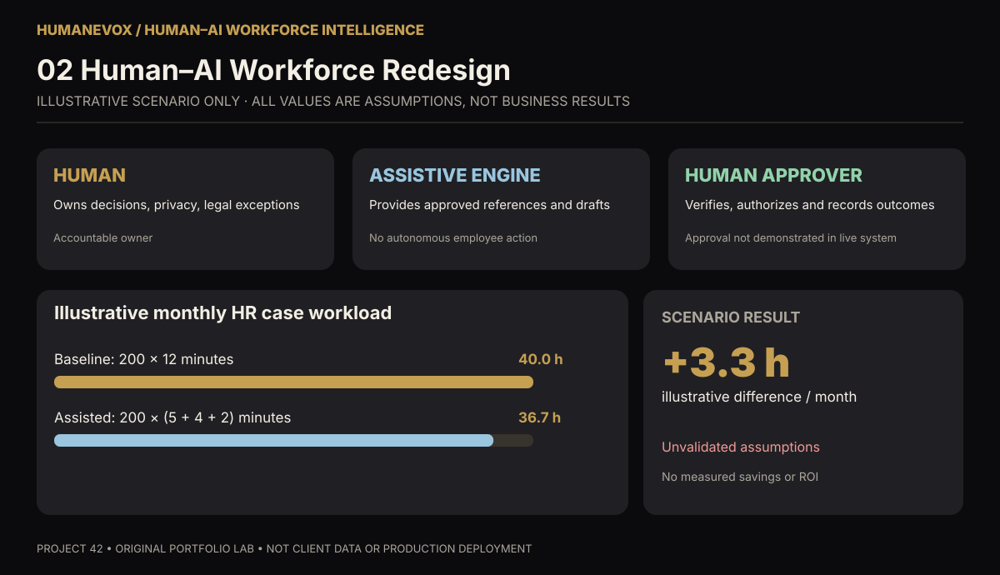
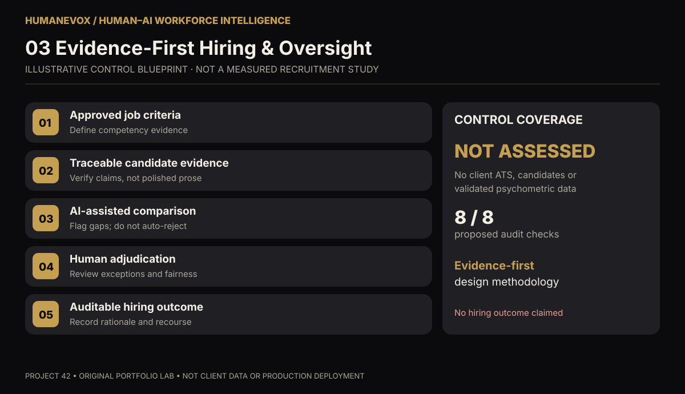

# HumanEvoX | Human–AI Workforce Intelligence Dashboards

**Three original executive dashboards for Portfolio Project 42.** This is a **professional portfolio laboratory**, not a named client engagement.

## Dashboard access

[Open interactive HTML source](human_ai_workforce_dashboard.html) — click **Download raw file** and open it locally in Chrome or Edge. It runs offline using HTML, CSS, SVG/CSS and vanilla JavaScript, with no external libraries or data transfers. GitHub's normal file view displays source code rather than running HTML.

### Dashboard 1 — Agent quality & governance (OBSERVED LOCAL CODE TEST)

**What is real:** 28 prompts were executed against a local deterministic JavaScript HR decision engine in [Project 43](../../../Agentic%20AI%20development/AI%20in%20HR%20%26%20Agentic%20Automation/43_Microsoft_Copilot_Studio_HR_Service_Agent_Prototype/evidence/2026-10-29_test_run.json) on 29 October 2026. Twenty-six passed both expected decision and source checks. A mandatory human-required flag appeared on 17 of 17 human-required cases, but the correct **approval route** was only selected in 2 of 3 cases. Ten of 11 expected source identifiers matched. No external HR system action was performed. **Release decision: HOLD.** This is not an LLM, Microsoft Copilot Studio or deployed HR agent test.

### Dashboard 2 — Human–AI workforce redesign (ILLUSTRATIVE)

**What is modeled:** Human ownership, AI/rules-engine assistance, approval boundaries, and an editable workload scenario using *invented input assumptions*. Default 200 monthly HR cases × [12 baseline minutes − (5 assisted + 4 review + 2 rework minutes)] / 60 = **+3.3 illustrative hours/month**. This is a sensitivity exercise, **not realized savings, ROI or a production forecast**.

### Dashboard 3 — Evidence-first hiring (FRAMEWORK ONLY)

**What is designed:** Five-stage, evidence-first recruitment decision process and eight manually assessable governance controls. No real candidates, scoring validity, fairness findings or client outcomes are represented. The interactive checklist is browser-local and does **not** itself prove controls are operational.

## Business case, methods, tools and results

Read [DASHBOARD_METHODOLOGY.md](../DASHBOARD_METHODOLOGY.md) for the hypothetical client pains, metric definitions, calculation logic, actual vs illustrative data, technical stack, limitations and recommended next validation stage.

## Reproducibility

- Dashboard 1 embedded case records are sourced from [Project 43's unchanged original evidence](../../../Agentic%20AI%20development/AI%20in%20HR%20%26%20Agentic%20Automation/43_Microsoft_Copilot_Studio_HR_Service_Agent_Prototype/evidence/2026-10-29_test_run.json).
- Observed results can be checked against [Project 43's test runner](../../../Agentic%20AI%20development/AI%20in%20HR%20%26%20Agentic%20Automation/43_Microsoft_Copilot_Studio_HR_Service_Agent_Prototype/test_agent.js).
- Dashboard calculations run client-side in plain JavaScript, with no API calls, external libraries or login.
- The three SVG graphics are static reference views. For dynamic drill-down and scenario sliders, download the HTML file.

**Author/portfolio:** Bircan Uzan · HumanEvoX · © 2026. Original visualizations informed by general evidence-based HR research; not affiliated with or endorsed by Nicolas Behbahani.
