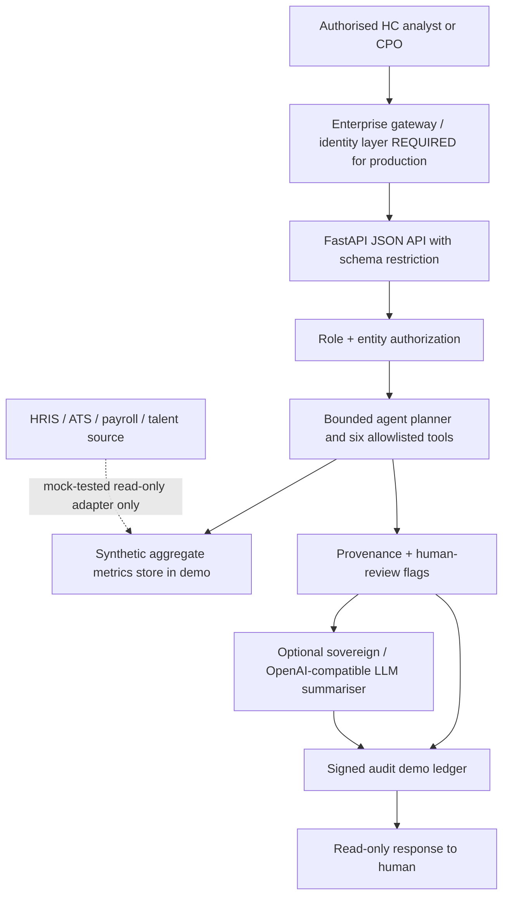

# Technical architecture & operational boundary

## Logical components

## System details
- Current API: GET /health, POST /v1/agent/run, POST /v1/agent/orchestrate and GET /v1/audit/verify. The `workforce_redesign` capability is read-only and accepts only `entity=ALL` because the pilot is group-scoped rather than entity-specific.
- Direct run contract: capability enum + entity enum + optional llm_summary Boolean. Bounded orchestration contract: a 3–300 character goal, entity enum and optional model-planning flag. This purpose-limited endpoint rejects potentially identifying or state-changing instructions; its simple guard is NOT comprehensive enterprise DLP. Only a scoped people-leader may call the orchestrator. Unexpected JSON fields are rejected.
- A separate workforce_redesign domain performs a deterministic synthetic task-to-role-to-org scenario (group scope only), with explicit reserve-human decision rights and zero headcount changes. Six original HC data tools are deterministic Python functions, with an optional seventh composite planner (executive_brief). Tool outputs have source/section, assumptions, flags, human review and explicit zero write actions.
- RBAC: development-only bearer token registry, with role and legal-entity scope. Enterprise Azure Entra ID/other signed OIDC token verification is *required but not implemented*.
- Audit: HMAC-chained records in SQLite; HMAC key from environment. For production use cloud audit service with immutable retention, secret rotation and independent assurance.
- Sovereign model: OpenAI-compatible HTTPS chat completions adapter on an operator-allowlisted host; optional model-generated narrative **or JSON proposed tool plan**. A separately enforced allowlist and role/entity gate control all local execution. No direct model tool calling. Not configured or verified with ai_enterprise.
- Integrations: allowlisted read-only HTTPS aggregate snapshot adapter with external system owner credentials; mocked in tests. No enterprise integration performed.
- Container: generic Python image and non-root process; suitable as initial baseline for Docker/Kubernetes evaluation, **not a hardened or deployed production image**.

## Azure deployment reference (future, not built)
Managed API ingress and WAF → Entra ID federation and scoped workload identity → AKS or Azure Container Apps → secret manager/Key Vault → sovereign/approved model inference endpoint → integration gateway → private source networks → encryption, audit exports, metrics/tracing and alerting. Implement regional data residency and jurisdiction-specific approvals. A sovereign LLM may use a non-OpenAI schema; provide an adapter and contract/UAT before claiming compatibility.

## Trust boundaries
- Data control plane (source data + business semantics) separated from model-generated narrative.
- Decisions stay with designated HC, Legal, Reward, Finance and authorised CPO representatives.
- No candidate selection, employee performance scoring, promotion, termination, pay changes or hiring approvals via this API.
- A local token is **not** sufficient enterprise identity; a Docker image is **not** proof of cloud readiness or SRE maturity.
- Explicit HCM integrations must validate source authorisation, effective dates, source-level rights, minimisation, reconciliation, retention and residency.
