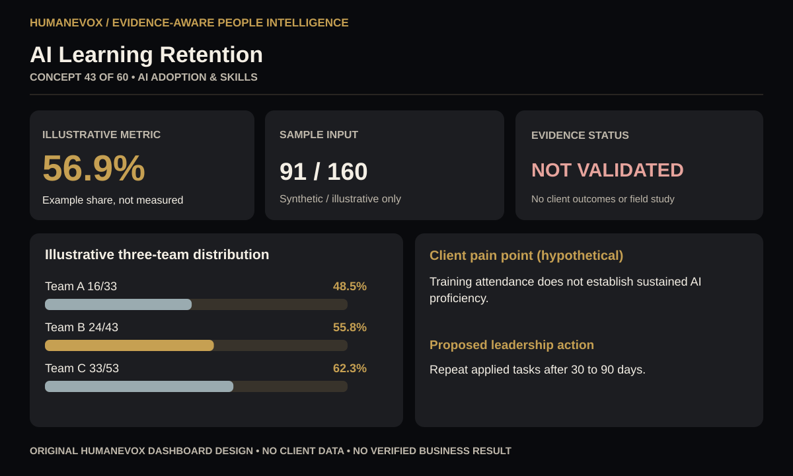

# 43 — AI Learning Retention | HumanEvoX Executive Dashboard

**Research concept:** AI Adoption & Skills  
**Source issue:** [Nicolas Behbahani — HR & People Analytics Research, 2026-09-06](https://www.linkedin.com/pulse/6-hr-studies-you-may-have-missed-week-ai-jobs-human-skills-behbahani-ruhbf)  
**Attribution:** Topic inspired by the cited newsletter. This visual design, case framing and example dataset are original HumanEvoX portfolio work. Published research findings and author's proposed metrics are not HumanEvoX field measurements.

## Client pain point — hypothetical

Training attendance does not establish sustained AI proficiency. This scenario illustrates a potential issue for an employer; it is **not a claim that HumanEvoX delivered work for a client**.

## Business question and operational indicator

**Question:** How well can the employer observe and govern ai learning retention?

**Metric specification:** Completers demonstrating agreed skill at follow-up / training completers.

**Calculation methodology:** Qualified records divided by eligible records multiplied by 100; document definition and exclusions.

**Example result using synthetic data:** 91 ÷ 160 × 100 = 56.9%. The illustration is invented for demonstrating an analytics workflow, **not published research data, a validated benchmark or a realized business outcome**.

**Interpretation:** Higher may indicate stronger coverage; validity and downstream outcomes still need independent evaluation. Do not infer causal effects from aggregated or cross-sectional rates.

## Proposed methodology

1. Agree an eligible population and precise operational definition with a business / HR policy owner.
2. Document data owners, collection period, source permissions, exclusions, consent basis and validation rules.
3. Derive counts or rates by appropriate role, period or cohort. Use small-cell suppression and aggregate reporting for sensitive data.
4. Inspect differences, contradictory evidence and data completeness. Have an independent reviewer confirm the labels and the context.
5. Compare appropriate historical baseline and later pilot period using consistent definitions; escalate concerns and document changes.
6. Recommend an action based on evidence, repeat measurement and record whether the intervention altered outcomes.

## Client decision and proposed action

Repeat applied tasks after 30 to 90 days.

**Intended deliverables:** diagnostic KPI specification, cohort visualization, risk questions, data dictionary, action owner and pilot evaluation plan.

## Technologies and tools actually used

GitHub, SVG, JavaScript-generated visualizations, Markdown, HTML/CSS/vanilla JS; no live Power BI/ATS/HRIS or client platform.

The executive SVG was produced as a standalone artifact; the collection also contains an interactive dashboard selector built in JavaScript. GitHub Markdown provides preview and traceable source attribution.

**Not used or claimed:** production employee data, psychometric validation, Power BI dashboard, enterprise HRIS/ATS integrations, observed AI model output, employer commissioning, statutory compliance certification, live deployment or verified KPI improvement.

## Result and evidence boundary

**Delivered:** reusable visual dashboard and metric calculation using clearly labeled synthetic values.  
**Not delivered:** evidence of changed employee outcomes, return on investment, causal impact, hiring validity or tested enterprise deployment.  
**Next validation:** request a defined scope and ethically obtained, approved data; independently validate the baseline and the role-relevant metric before a client-facing claim.

Related project: [Project 42 Human–AI Workforce Design and Agent Governance](../../../42_Human-AI_Workforce_Design_and_Agent_Governance/), which separately contains real execution traces from a **local deterministic rules-engine test**, not a live LLM pilot.

© 2026 HumanEvoX / Bircan Uzan. Not affiliated with or endorsed by Nicolas Behbahani.
